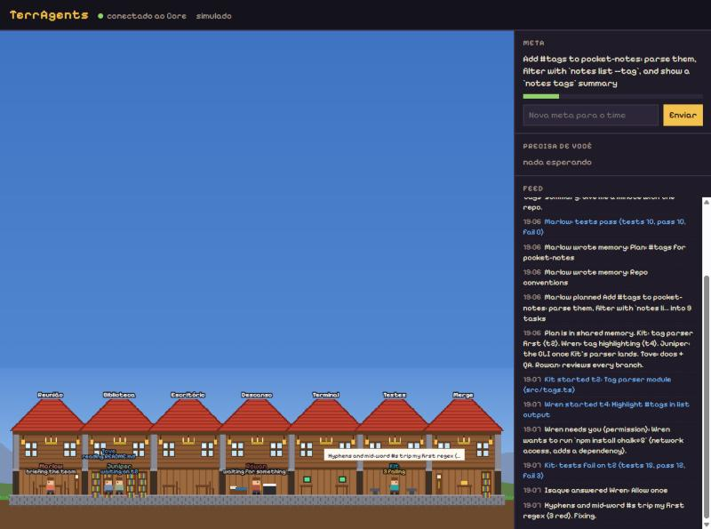
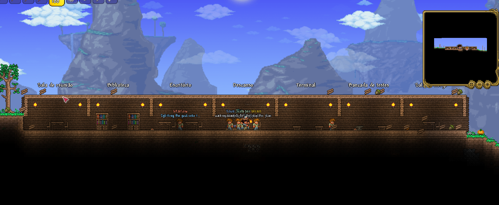

# TerrAgents

**Uma cidade onde uma equipe de agentes de IA trabalha sozinha num repositório de verdade.**
Você dá a meta. O líder planeja, os trabalhadores programam cada um no seu worktree, os testes julgam,
o merge acontece e o push sai, sem ninguém aprovar nada no meio. Você assiste pelo navegador ou de dentro
do Terraria.

> [!WARNING]
> **Use por sua conta e risco.** É um projeto experimental de fã. Com o piloto automático, agentes de IA fazem
> merge e push no seu repositório sem revisão humana. Os autores não se responsabilizam por merges automáticos,
> erros ou ações dos agentes, perda de dados, custos ou qualquer outro dano. Leia o [DISCLAIMER.md](DISCLAIMER.md)
> antes de usar com agentes de verdade.



*English summary at the end.*

---

## Como funciona

```
 você ── meta ──▶ TerrAgents Core (Node 22) ──▶ agentes Claude (líder + até 5 trabalhadores)
                        │   piloto automático: policy.json responde permissões, perguntas e merges
                        │   Validator: só entra no main o que passa nos testes
                        ▼
            WebSocket ws://127.0.0.1:7878 (protocolo v1)
               │                         │
     navegador (viewer/)         Terraria (terraria-mod/, tModLoader)
```

- **O Core decide tudo.** As visões (navegador, Terraria, terminal) só desenham e mandam comandos.
- **Cada tarefa tem o seu worktree e a sua branch.** Os agentes nunca mexem na sua cópia nem fazem push;
  quem integra é o Core, depois dos testes.
- **Piloto automático.** As decisões que o AgentCraft original pedia a você agora seguem um `policy.json`:
  - o merge só acontece com testes verdes;
  - com teste vermelho, o trabalho volta para o agente até 5 vezes;
  - permissões fora da regra são negadas, e o agente procura outro caminho.
- **Tetos de gasto.** Cada tarefa tem limite de tempo e de custo. O dia tem um teto, e quando ele chega o
  time pausa e pergunta se você quer continuar. É a única pergunta que chega até você.

## Começar em 2 minutos (modo simulado, sem custo)

Precisa de [Node.js 22+](https://nodejs.org) e git.

```bash
git clone https://github.com/HiveControlAgents/terragents.git
cd terragents/core
npm install
npm run demo
```

Abra **http://127.0.0.1:7878/**. Uma equipe simulada (sem IA, sem gasto) planeja e entrega uma funcionalidade
num repositório de demonstração. Você vê o salão de guilda, o feed e as decisões.

## Com agentes de verdade

1. Tenha uma chave da API da Anthropic em `ANTHROPIC_API_KEY`. Se for só para uso pessoal, também dá para
   usar o login do `claude` com `--use-claude-login`.
2. Copie `core/policy.example.json` para `~/.terragents/policy.json` e ajuste os tetos.
3. Rode, apontando para o seu repositório e o comando de testes dele:

```bash
npm run start -- --backend claude --accept-risk --repo /caminho/do/seu/repo --ci "npm test" --goal "Sua meta aqui"
```

Sem `--accept-risk` (ou `TERRAGENTS_ACCEPT_RISK=1`), o Core se recusa a ligar agentes de verdade com o piloto
automático: a flag é você dizendo que leu o [aviso](DISCLAIMER.md) e assume os riscos.

Opções úteis: `--workers 2`, `--lead-model sonnet --worker-model sonnet`, `--effort low` (mais barato),
`--no-autopilot` (você mesmo aprova cada decisão), `--help` para todas.

### policy.json

| Campo | Padrão | O que faz |
| --- | --- | --- |
| `maxAttempts` | 5 | rodadas de correção antes de rejeitar a tarefa |
| `maxMinutesPerTask` | 45 | tarefa em andamento além disso é cancelada (dá para `retry`) |
| `maxUsdPerTask` | 1,5 | custo estimado máximo por tarefa |
| `dailyUsd` | 0,33 | teto do dia; ao chegar, pausa e pergunta |
| `requireTests` | true | merge só com testes passando |
| `push` | `"direct"` | `"direct"` faz push do branch base, `"pr"` abre um pull request (branch protegido), `"off"` fica local |
| `permissions.allow` | `[]` | expressões regulares de comandos liberados (ex.: só `python -m pytest`) |

## No Terraria (opcional)

Precisa do Terraria e do [tModLoader](https://store.steampowered.com/app/1281930/tModLoader/) (grátis).

1. Copie `terraria-mod/TerrAgents` para `Documentos/My Games/Terraria/tModLoader/ModSources/`.
2. Compile em **Workshop → Develop Mods → Build + Reload**. Isso precisa do .NET 8 SDK. Sem o SDK,
   compile com o tModLoader fechado; os detalhes estão em [terraria-mod/README.md](terraria-mod/README.md).
3. Com o Core ligado, entre num mundo. Os agentes aparecem como NPCs.
4. Digite `/ta construir` num mundo de teste para levantar o salão de guilda, com um escritório por setor.



Comandos no chat: `/ta` (estado), `/ta meta <texto>`, `/ta responder <id> <opção>`, `/ta falar <agente> <texto>`.

## Estrutura

```
core/          TerrAgents Core: orquestrador (Node 22 + TypeScript), piloto automático, servidor WebSocket/HTTP
viewer/        a página do navegador (um arquivo, canvas, sem dependências)
terraria-mod/  mod do tModLoader (C#): cliente que só desenha
protocol/      protocolo WebSocket v1 entre o Core e as visões
docs/          arquitetura e a especificação original do AgentCraft
```

Testes: `cd core && npm test`.

## O que vem por aí

- Balões de conversa entre agentes e vida/cansaço visíveis na cidade.
- O time contratar um agente novo sozinho quando faltar gente.
- Vários projetos ao mesmo tempo, cada um num bairro.
- Multiplayer no Terraria.

## Segurança

- Os agentes nunca fazem push. O git deles recusa qualquer rede, e só o Core integra e publica.
- O WebSocket só aceita a própria página do Core e clientes locais. Outros sites são recusados.
- Nada do Terraria (sprites, sons) é distribuído aqui. O mod usa o jogo que cada pessoa tem.
- Nunca coloque chaves no repositório. A chave fica na variável de ambiente.

## Responsabilidade

O TerrAgents é distribuído "no estado em que se encontra", sem garantia de nenhum tipo (licença MIT). Quem usa
assume todos os riscos: merges automáticos, código errado, arquivos apagados, falhas de segurança, custos de API e
qualquer ação dos agentes. Os autores e contribuidores não respondem por nenhum dano. Detalhes em
[DISCLAIMER.md](DISCLAIMER.md). O mod é um projeto de fã, não oficial, sem ligação com a Re-Logic.

## Origem e licença

Fork do [AgentCraft](https://github.com/blendi-remade/agentcraft) (MIT), que mostrava o mesmo time dentro do
Minecraft com aprovações humanas. O TerrAgents troca as aprovações por um piloto automático, troca o Minecraft
pelo navegador e pelo Terraria, e mantém o copyright original. Veja [LICENSE](LICENSE) e [NOTICE](NOTICE).

---

## English summary

TerrAgents is a fork of AgentCraft. It runs a team of Claude agents on a real git repository with no human
approvals. An autopilot reads `policy.json`: merges need green tests, failed work goes back to the agent, and
spend is capped per task and per day. When the daily cap is reached, the team pauses and asks you whether to
continue. You watch the team as a guild hall in the browser (`http://127.0.0.1:7878/`) or inside Terraria
through a tModLoader mod.

Quick start with no cost: `cd core && npm install && npm run demo`, then open the page. The license is MIT.

**Use at your own risk.** Real agents with the autopilot need `--accept-risk`. The authors accept no liability
for automatic merges, agent mistakes or actions, data loss, costs or any other damage. See
[DISCLAIMER.md](DISCLAIMER.md). Unofficial fan project, not affiliated with Re-Logic.
